# freecad-wire-harness
Parametric wire harness for FreeCAD: wires, twists and coverings driven by spreadsheets, with a Harness Designer window to drag and bend them in the 3D view.

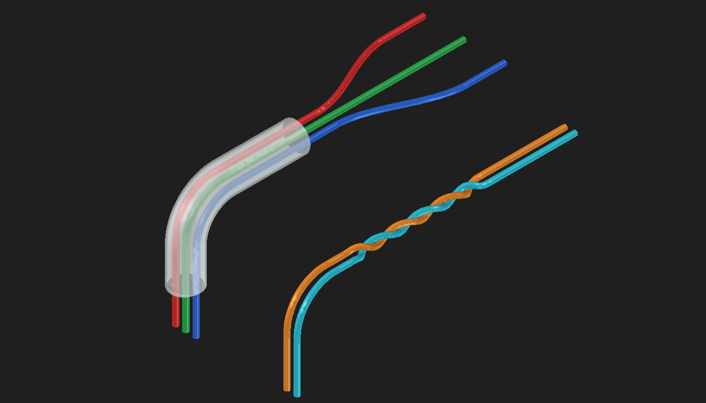

Every wire is a row in a spreadsheet, and its points are the rows of another one. The module turns them into smooth, round wires of the right thickness and the exact length, and rebuilds them whenever a cell changes. The **Harness Designer** window, which stays open next to the 3D view, edits those cells for you: pick a wire and a point, then move it, turn it, or drag it in the 3D view.

> **Status:** written and tried in FreeCAD 1.1 on Windows; other versions and systems are untested.
> All pictures below come from small made-up demos, not from a real harness.

## What it does

- **Wires.** Smooth spline wires through the points you give, each with its own outer diameter, color, minimum bend radius and total length. The length is always exact: a wire with a free end continues straight for whatever length is left, and a wire with a fixed end is tightened or sags to fit.
- **Editing in the 3D view.** Move a point, turn its heading, add or delete points, add or delete wires. A gizmo (arrows, a ball and rings) drawn on the selected point lets you do it with the mouse.
- **Bending leaves the rest alone.** Moving or turning a point changes only the stretches next to it, and a wire that is bent does not get longer than its Length.
- **Coverings.** Hollow tubes (sleeves) around a bundle of wires, drawn see-through so the wires inside can be seen.
- **Twisted wires.** Two or more wires winding around each other along a stretch, with a lay length and a hand. The extra wire the twist needs is worked out for you.
- **Collision check.** Finds wires that touch, overlap or come closer to each other than a minimum gap, and marks them in the 3D view.
- **Everything is in the document.** The wires, points, twists and coverings are ordinary FreeCAD spreadsheets and objects, so they are saved with the file and you can also edit them by hand.

## Install

1. **Find FreeCAD's macro folder.** In FreeCAD choose **Macro > Macros...**; the **Macro path** at the top of the dialog is the folder. (It is also set under **Edit > Preferences > General > Macro**, and `App.getUserMacroDir(True)` in the Python console prints it.) For FreeCAD 1.1 on Windows it is `%APPDATA%\FreeCAD\v1-1\Macro`.
2. **Copy these two files into that folder:**

   | File | What it is |
   | --- | --- |
   | `wire_harness.py` | The module: all the code. |
   | `Harness_Designer.FCMacro` | A short launcher (two lines of code) that opens the Harness Designer window. |

   Both files must be in the same folder: the macro does `import wire_harness`, and FreeCAD has its macro folder on Python's path.
3. **Run it.** Choose **Macro > Macros...**, select `Harness_Designer` and press **Execute**. (FreeCAD's Customize dialog can also put the macro on a toolbar or give it a keyboard shortcut.)

Instead of copying, you can clone this repository anywhere, point FreeCAD's **Macro path** at the clone (**Edit > Preferences > General > Macro**) and restart FreeCAD; then `git pull` updates the files in place. FreeCAD has one macro folder, so macros you keep in the old folder are not listed while the Macro path points to the clone.

After you replace `wire_harness.py` while FreeCAD is running, restart FreeCAD: Python keeps the old module until then.

## The Harness Designer window

The window works in any document. With no wire harness yet it makes an empty one (the wires table `HarnessTable` and the harness object `Wire_Harness`), with no document open it makes a new one, and with no wires it opens the **New wire** form so you can draw the first wire. It is not modal: it stays open next to the 3D view while you work. Hover over any control to read its tooltip.

The top of the window is always the same:

- **Wire** and **Point** choose what you are working on. The Point list starts with "Start (where the wire begins)" and goes on with the points of the wire's points sheet, named by their row there: "Row 5 (via)", "Row 6 (via)" and so on. The selected point is marked in the 3D view with a yellow ball and an arrow along its heading.
- **Later points follow.** On: the points after the one you move or turn move or swing with it, so the rest of the wire keeps its shape. Off: only that point changes.
- At the bottom: the result of the last collision check, and **Close**.

The rest is in four tabs.

### Point tab: move, turn, add, delete

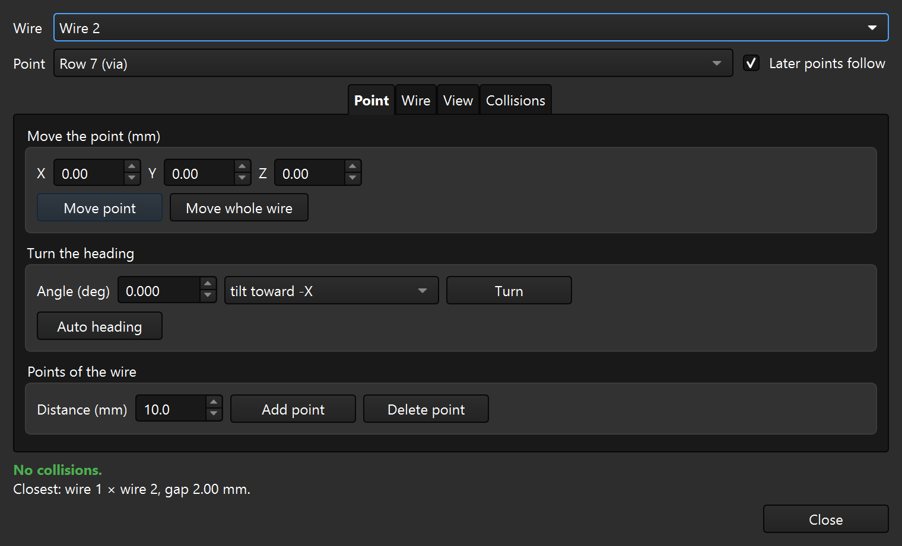

- **Move the point (mm).** Type X, Y and Z amounts. **Move point** moves the selected point by them; **Move whole wire** moves the start of the wire and every point.
- **Turn the heading.** The heading is the direction the wire is going in at a point. Give an angle in degrees and a mode (tilt toward -X, +X, -Y, +Y, up or down, or turn clockwise or counter-clockwise around the vertical axis seen from above), then press **Turn**. **Auto heading** gives the choice back to FreeCAD, which picks a smooth heading again.
- **Points of the wire.** **Add point** puts a new point the **Distance (mm)** you type after the selected one, measured along the wire where it runs now; the other points stay put. If the next point is nearer than that, the new point goes halfway to it. After the last point the wire is extended by that distance (and its Length grows if it has to). **Delete point** removes the selected point; the points after it keep their positions.

#### Bending leaves the rest of the wire alone

Moving or turning a point changes only the stretches next to it. The point before it and the point after it keep their headings: those headings become fixed (they are written into the Dir columns of the points sheet) until you press **Auto heading** on them.

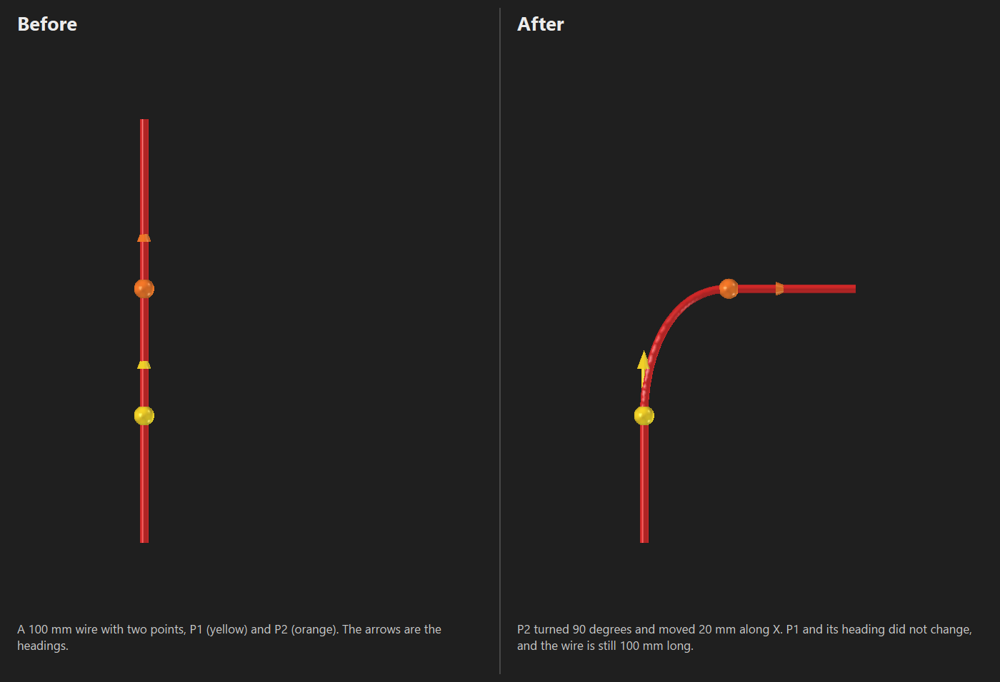

In the picture, P2 was turned 90 degrees and moved 20 mm along X. The stretch from the start to P1, and the heading of P1, did not change.

A wire with a free end also keeps its **Length**. If an edit would make the curve longer than the Length, the window pulls the last point in toward the one before it, just far enough, and says how much in FreeCAD's status bar. (In the picture the wire is still 100 mm long.) An edit that cannot be built at all is refused, and nothing is changed.

### Wire tab: length, color, coverings, twists, wires

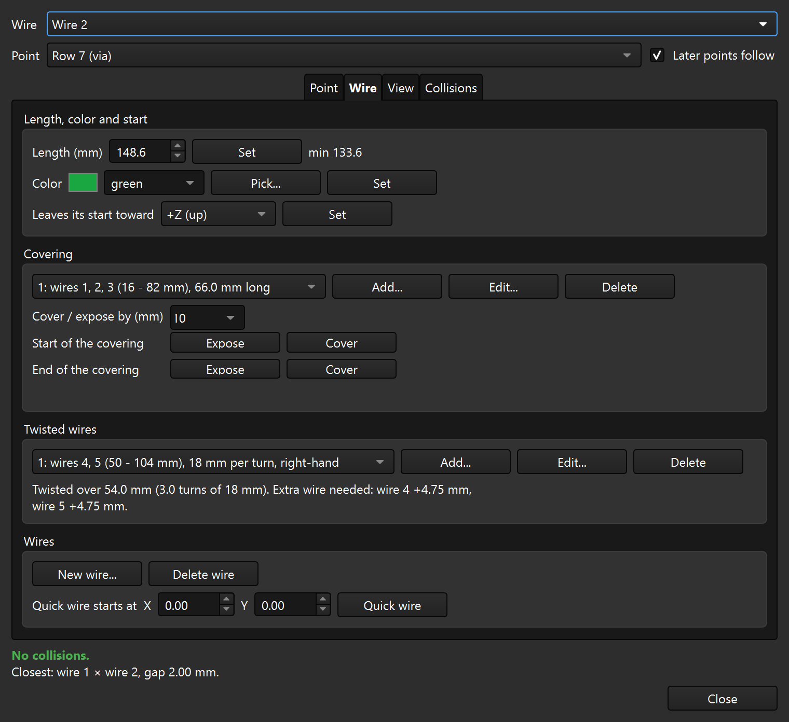

- **Length, color and start.** **Length (mm)** is the total length of the selected wire; next to it the window says "min 60.0", the shortest length the points allow, or "fixed end" for a wire whose last point is an `end` row. **Color** takes a name, a code such as `#00aa44`, or **Pick...**; empty means an automatic color. **Leaves its start toward** is the direction the wire leaves its start point in (+Z up, -Z down, +X, -X, +Y, -Y). Each has its own **Set** button.
- **Covering.** The coverings of the harness are listed; **Add...**, **Edit...** and **Delete** manage them (the form is shown below). **Cover / expose by** is a step in mm: **Expose** and **Cover** at the start or at the end of the chosen covering shorten or lengthen it by that step.
- **Twisted wires.** The same for twists. A line under the list tells how long the twist is, how many turns it makes and how much extra wire each wire needs.
- **Wires.** **New wire...** opens the form below. **Delete wire** deletes the selected wire and its points sheet (it asks first). **Quick wire** adds a straight 10 mm wire in one click: it takes the thickness and direction of the selected wire, gets the next number and its own color, and starts at the X and Y offset you type next to the button (from the start of the selected wire).

### View tab: the gizmo and the wire path

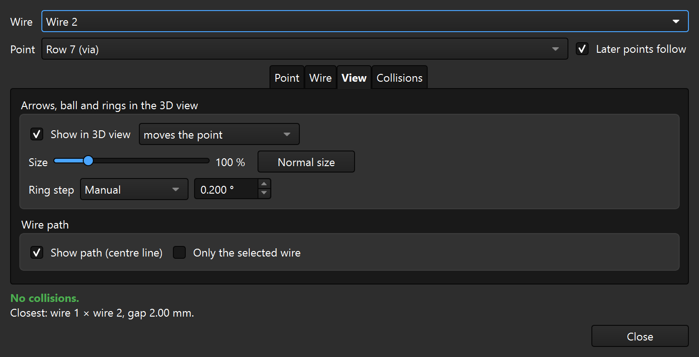

The **gizmo** is drawn on the selected point in the 3D view:

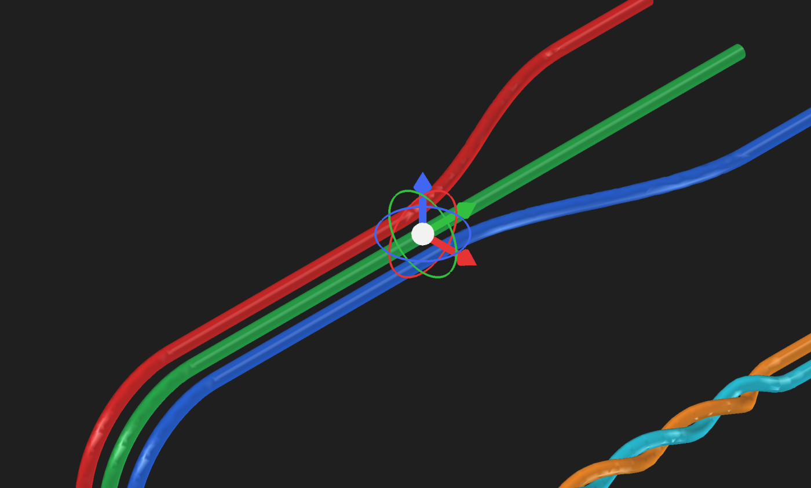

- The three **arrows** move the point along X (red), Y (green) or Z (blue).
- The **ball** moves it across the view.
- The three **rings** turn its heading around X, Y or Z.

Drag with the left mouse button. While you drag, a label shows the distance and the new position and a dashed line shows how the wire will run; for a ring, a dial with a mark every 5 degrees shows the angle. While the button is down, hold **Shift** for fine control (the mouse counts a tenth), press an arrow key to nudge (0.1 mm, or one ring step), or press **Esc** to cancel. The wires update when you let go.

The tab sets whether the gizmo is shown (**Show in 3D view**), whether the arrows and the ball move the point or the whole wire (the rings are hidden for the whole wire), its **Size** (50 to 300 per cent, remembered for next time; **Normal size** goes back to 100) and the **Ring step**, the angle a ring turns by: 1, 0.5, 0.1, 0.05 or 0.01 degrees, 5, 15 or 45 degrees, or **Manual** with your own value from 0.001 to 90 degrees.

**Show path (centre line)** draws the real line through the middle of the wires over the 3D view, in cyan and thicker for the selected wire and white for the others. It shows through the wires and the coverings, and nothing is added to the document. **Only the selected wire** limits it to the chosen wire.

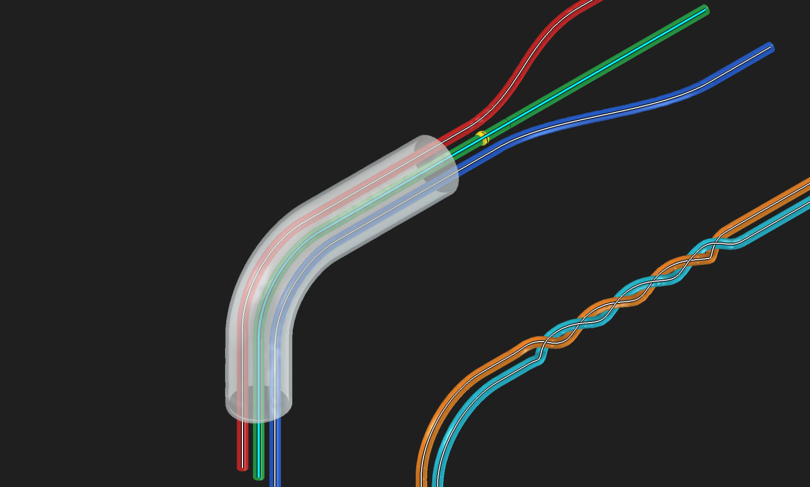

### Collisions tab

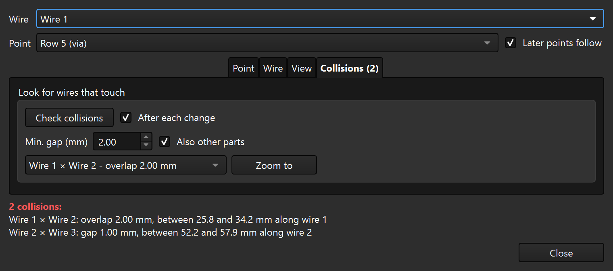

**Check collisions** treats every wire as a tube of its outer diameter and looks for wires that touch or overlap (red). With a **Min. gap** above 0, wires that come closer to each other than that count too (orange). The collisions are listed in the window and marked in the 3D view; **Zoom to** moves the view to the one chosen in the list.

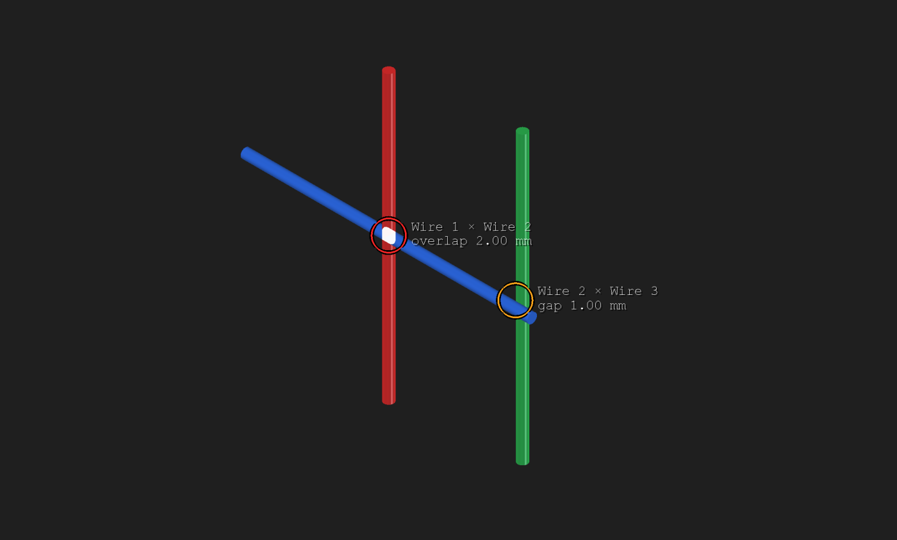

**After each change** repeats the check whenever a wire changes: in the window, with the gizmo, or with undo and redo. **Also other parts** also looks for wires that go through the other solids in the document (a connector, for example). That is a little slower, and only overlaps count there, not the gap. Wires that go through a covering are always reported, with or without this.

### The forms

**New wire...** asks for the wire number, where it starts, the direction it leaves its start in, color, outer diameter, minimum bend radius and total length, and a shape: a wire with one bend (with the straight run before the bend, the bend angle, the bend radius and the side it bends toward), a straight wire, or a copy of the points of an existing wire. To start the wire at a vertex of another part (a connector pin, for example), select that vertex in the 3D view *before* you open the form: the form then starts there, and **Use the selected point** takes it again. The 3D view cannot be used while a form is open.

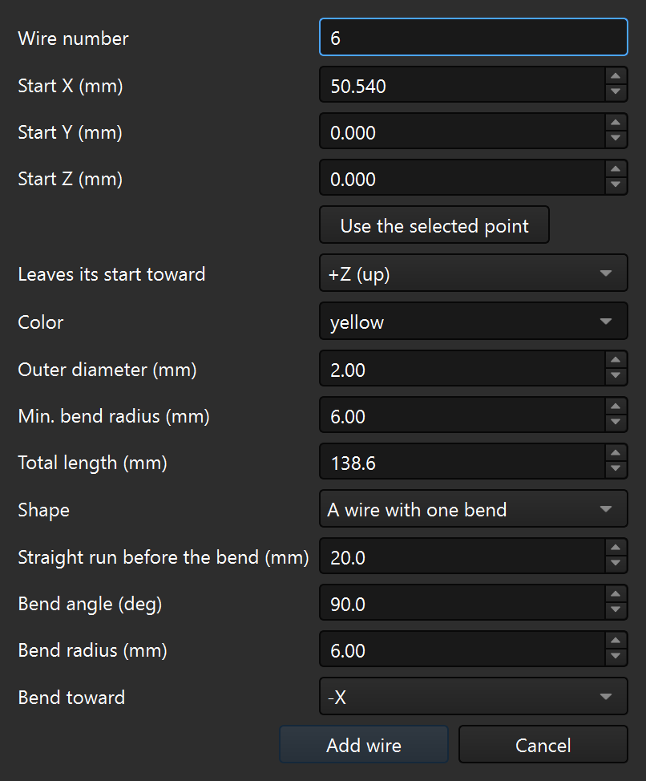

A **covering** goes around the wires you tick (wires that run side by side; the first one ticked is the reference for the other numbers), from a point along the first of them for a length, or until the end of the wire. The inner diameter can be left on **automatic**, which is the bundle plus a little room. The form also has the wall thickness, the color and the same **Expose** / **Cover** steps, and a line that tells how long the covering is and the smallest inner diameter the wires need there. A wire that goes its own way cannot be inside the same covering: the form says so in red and offers **End it where the wires split**.

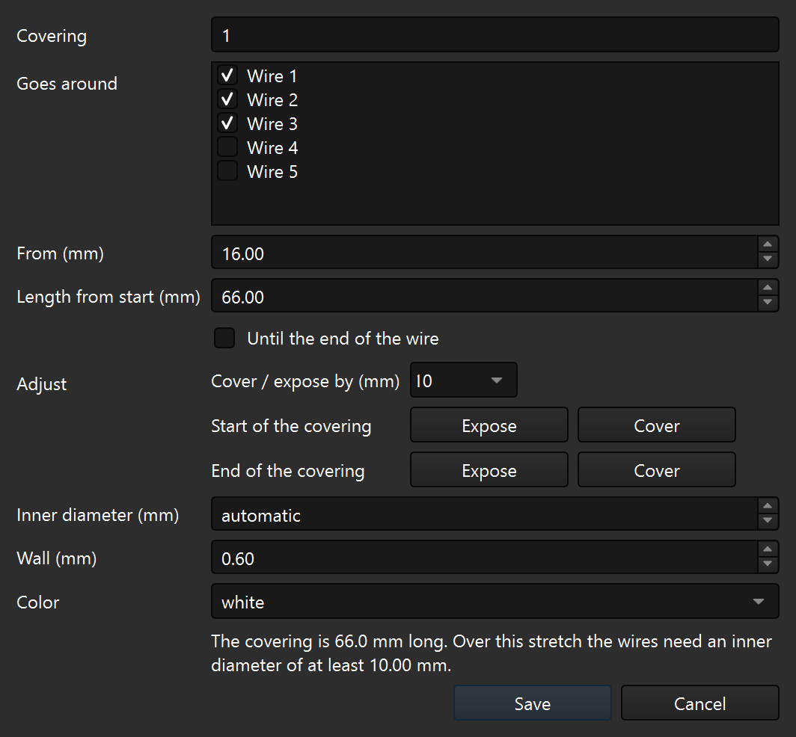

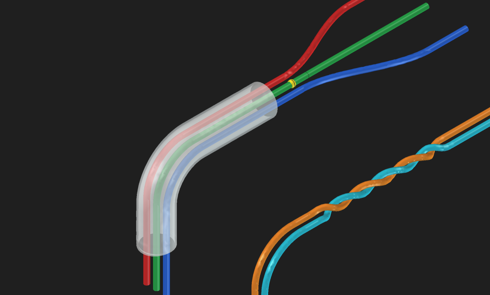

A **twist** winds the wires you tick (two or more, running side by side; wires that are already in a twist are greyed out) around each other, from a point along the first of them for a length, or until the end of the wires. The **lay length** is how far along the wires one full turn is (a smaller number is a tighter twist), and the **hand** is right-hand or left-hand. The ends and the lengths of the wires stay as they are; the form shows how many turns the twist makes and the extra wire each wire needs. Wires that are further than 15 mm apart cannot be twisted together.

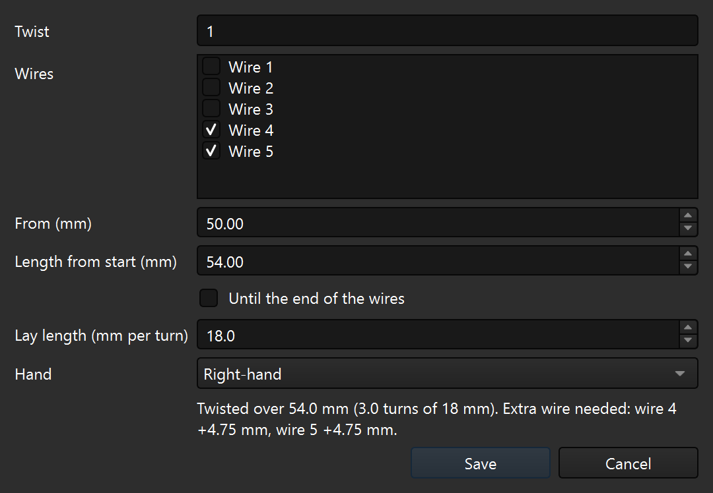

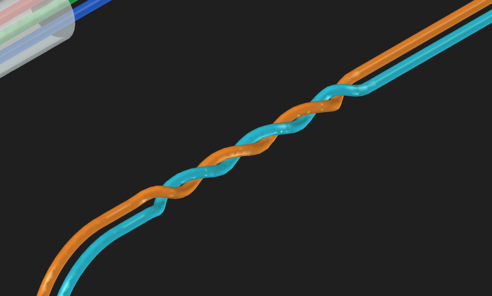

## The spreadsheets

The window only writes into spreadsheets, and the harness is rebuilt from them, so you can edit them by hand as well. Headers are in row 4, data starts in row 5, and blank rows are skipped.

### `HarnessTable`: the wires

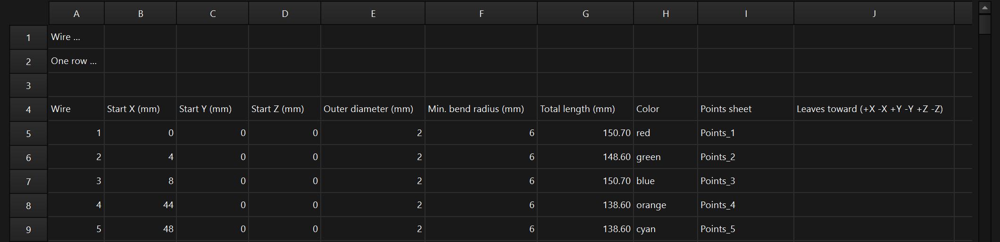

| Column | Meaning |
| --- | --- |
| Wire | The name of the wire. |
| Start X, Y, Z (mm) | Where the wire begins. |
| Outer diameter (mm) | Thickness of the wire. |
| Min. bend radius (mm) | Only used for warnings in the wire report. |
| Total length (mm) | The exact length of the wire. |
| Color | A name (red, blue, green, yellow, orange, purple, cyan, brown, pink, black, white, gray or grey) or `#RRGGBB`. Blank: a color chosen by the order of the wires. |
| Points sheet | The sheet with the points of this wire (default `Points_<wire>`). |
| Leaves toward | The direction the wire leaves its start point in: `+X -X +Y -Y +Z -Z`, or three numbers `x, y, z`. Blank: straight up (+Z). |

A new row gets its points sheet created and linked on the next recompute, as a copy of the points of the previous wire.

### `Points_<wire>`: the points of one wire

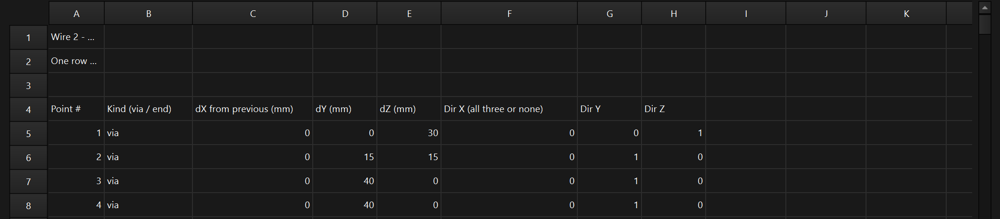

One row per point. **dX, dY, dZ are offsets from the previous point** (the first one from the start of the wire). **Kind** is `via` or `end`. **Dir X, Y, Z** are optional (all three or none) and fix the heading of the wire at that point; without them FreeCAD chooses a smooth one.

The wire leaves its start point in the direction of the last column of the wires table and passes through its points, in row order, as a smooth chain of cubic curves.

- **No `end` row (free end):** after the last point the wire continues straight for whatever length is left, so the total length is exact.
- **An `end` row (the last row):** the end position is fixed. The total length is made exact by tightening the curve (when it must be shorter) or by letting the slack hang as a downward sag (when it must be longer).

### `TwistTable`: twisted wires

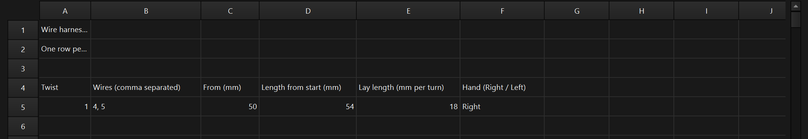

One row per twist: the twist number, the wires (comma separated; the first is the reference for the next two numbers), where the twist starts (**From**, in mm along the reference wire from its start), how long it is (**Length from start**, in mm counted from **From**; blank means to the end of the wires), the **Lay length** in mm per turn, and the **Hand** (`Right` or `Left`). A wire can be in one twist only.

### `CoveringTable`: coverings

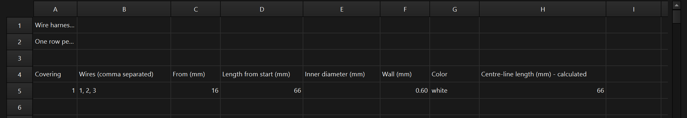

One row per covering: the covering number, the wires it goes around (comma separated; the first is the reference), **From** (mm along the reference wire from its start) and **Length from start** (mm counted from **From**; blank means to the end of the wire), **Inner diameter** (blank means automatic), **Wall**, **Color** (a name or `#RRGGBB`) and a last column with the centre-line length, which the program works out (do not type in it).

## Use it from Python

Everything the window does is also a function of the module. In FreeCAD's Python console:

```python
import FreeCAD as App
import wire_harness as wh

doc = App.newDocument("Harness")
harness = wh.ensure_harness(doc)      # the wires table (HarnessTable) and the harness object (Wire_Harness)

# Three wires side by side, 4 mm apart. Each leaves its start going up, runs 30 mm, bends 90 degrees
# toward +Y (radius 15 mm) and runs on for 40 mm. Each wire is 110 mm long.
for k, (name, color) in enumerate([("1", "red"), ("2", "green"), ("3", "blue")]):
    points = wh.bend_points(lead=30, angle=90, radius=15, toward=(0, 1, 0)) + [("via", (0, 40, 0), (0, 1, 0))]
    wh.add_wire(doc, harness, name, 4 * k, 0, 0, points, od=2.0, total=110.0, color=color)

# A covering around the three wires, from 16 mm to 82 mm along wire 1.
wh.add_covering(doc, harness, ["1", "2", "3"], start=16, end=82, wall=0.6, color="white")

# Two more wires, 2.2 mm apart, twisted together from 50 mm to 100 mm along wire 4:
# 25 mm per turn, right-handed. Their minimum bend radius is 4 mm.
for k, (name, color) in enumerate([("4", "orange"), ("5", "cyan")]):
    points = wh.bend_points(lead=20, angle=90, radius=15, toward=(0, 1, 0)) + [("via", (0, 80, 0), (0, 1, 0))]
    wh.add_wire(doc, harness, name, 44 + 2.2 * k, 0, 0, points, od=2.0, radius=4.0, total=140.0, color=color)
wh.add_twist(doc, harness, ["4", "5"], start=50, end=100, lay=25, hand=1)

doc.recompute()
print("\n".join(harness.WireReport))     # one line per wire and per twist
result = wh.check_collisions(doc)        # also prints the result in the Report view
print(len(result["collisions"]), "collisions")
```

It prints:

```text
Wire 1: free end: 93.6 mm curve + 16.4 mm straight end = 110.0 mm, tightest bend 14.9 mm
Wire 2: free end: 93.6 mm curve + 16.4 mm straight end = 110.0 mm, tightest bend 14.9 mm
Wire 3: free end: 93.6 mm curve + 16.4 mm straight end = 110.0 mm, tightest bend 14.9 mm
Wire 4: free end: 123.6 mm curve + 16.4 mm straight end = 140.0 mm, twisted with wire 5 (+2.01 mm of wire), tightest bend 5.3 mm
Wire 5: free end: 123.6 mm curve + 16.4 mm straight end = 140.0 mm, twisted with wire 4 (+2.01 mm of wire), tightest bend 5.3 mm
Twist 1: Twisted over 50.0 mm (2.0 turns of 25 mm). Extra wire needed: wire 4 +2.01 mm, wire 5 +2.01 mm.
0 collisions
```

A point is `(kind, (dx, dy, dz), heading)`: `kind` is `"via"` or `"end"`, the offset is measured from the previous point, and `heading` is a direction or `None` to let FreeCAD choose. In `add_covering` and `add_twist`, `start` and `end` are positions along the first wire, counted from its start (`end=None` means to the end of the wire); the spreadsheets hold the length instead, so the covering above is written as From 16 and Length from start 66. These are the main functions (most have a docstring, so `help(wh.add_wire)` works):

| Function | What it does |
| --- | --- |
| `harness_designer()` | Opens the Harness Designer window (what the macro calls). |
| `ensure_harness(doc)` | The harness of the document; a document without one gets an empty harness. |
| `add_wire`, `remove_wire`, `duplicate_wire` | Add, remove or copy a wire. |
| `bend_points(lead, angle, radius, toward)` | The points of a wire with one bend. |
| `set_wire_length`, `set_wire_color`, `set_wire_direction` | Change the length, color or start direction of a wire. |
| `move_point`, `rotate_point_about`, `clear_heading` | What **Move point**, the rings and **Auto heading** do. |
| `add_point`, `delete_point` | Add or delete a point of a wire. |
| `new_straight_wire` | What **Quick wire** does. |
| `add_covering`, `update_covering`, `remove_covering` | Coverings. |
| `add_twist`, `update_twist`, `remove_twist` | Twisted wires (`hand` is 1 for right, -1 for left). |
| `check_collisions(doc, min_gap, parts)`, `find_collisions` | Look for wires that touch, overlap or come too close. `check_collisions` prints the result in the Report view and returns it. |

The report lines are also in the `WireReport` property of the `Wire_Harness` object (in the Data tab of the property editor, under Result). A bend tighter than the wire's minimum bend radius ends the line with a warning: with `lay=12` in the example, the twisted wires say `WARNING: tightest bend 1.7 mm is below the 4.0 mm minimum`.

## Notes

- Written and tried with FreeCAD 1.1 on Windows only.
- The harness is saved in your document as ordinary spreadsheets plus the `Wire_Harness` object, which `wire_harness.py` rebuilds. Install the module wherever you want to open the file and change it.
- While the window is open, the document also has a small object `Wire_Point_Marker` (the yellow ball on the selected point). It is removed when the window closes.
- The window keeps a few settings (the gizmo size, the last tab, the ring and covering steps, the collision options) in FreeCAD's user parameters, under `BaseApp/Preferences/Mod/WireHarness`.
- The minimum bend radius of a wire is only used for warnings in the wire report; it does not change the shape.
- The collision check is slower when the harness has twisted wires.
- All the code is one file, `wire_harness.py` (about 6,300 lines).

## License

MIT, see [LICENSE](LICENSE).
